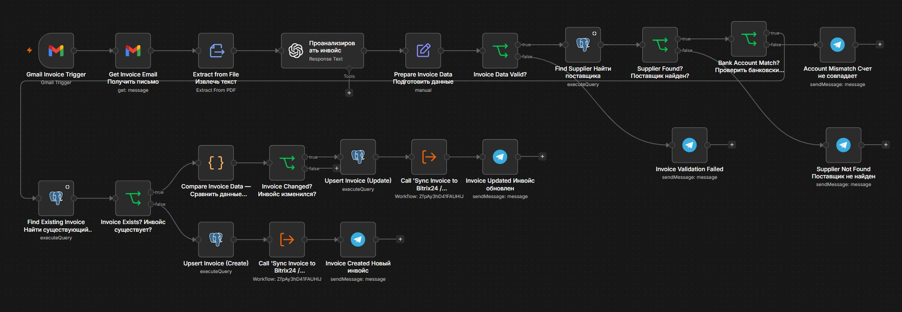
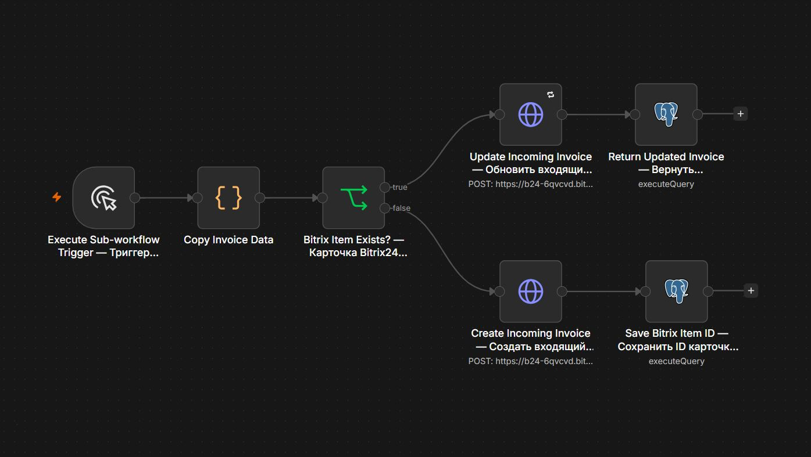

# AI Invoice Processing Engine

[Русская версия](README_RU.md)

## Run the standalone web demo

The repository now includes a **Russian-language React + TypeScript + Vite interface**. It runs on fictional local fixtures without n8n, PostgreSQL, or external integrations.

Requires **Node.js 24.15+ or 22.22.2+** (verified on 24.20.0). From the repository root:

```sh
npm ci
npm run dev
```

Open **http://127.0.0.1:5173/**. On Windows PowerShell, use `npm.cmd ci` and `npm.cmd run dev` if script execution is restricted.

For a phone on the same local network, run **`npm run dev:lan`** instead of `dev` (`npm.cmd run dev:lan` in PowerShell). Open Vite's printed `Network` address on the phone, for example `http://192.168.0.107:5173/`. The IP may change when reconnecting to Wi-Fi. This listens on port 5173 on the computer's network interfaces; it does not deploy the site or create an internet tunnel. The regular `dev` command remains loopback-only.

Select a scenario and click **«Обработать тестовый счёт»**:

| Scenario | Expected result |
| --- | --- |
| Valid new invoice | Four checks pass; simulated record created, version 1, «Обработано». |
| Unchanged duplicate | No new record, no update; existing version 1 retained. |
| Changed invoice | Amount and VAT change; the same simulated record is updated, version 1 → 2. |
| Bank account mismatch | «Требуется ручная проверка»; no record is saved, duplicate lookup is skipped. |

Scenarios start from independent fixtures and work in any order. The UI includes extracted fields, readable check results, changed values, upload validation, loading, cancellation, and error states, with a responsive layout.

**Your own PDF:** select or drop one PDF up to 10 MB. The browser checks its type, size, and signature. Demo mode never uploads it, extracts its contents, or substitutes fabricated results. Processing an arbitrary PDF requires a separately implemented backend.

```sh
npm test          # Scenario, adapter, file validation, and response contract tests
npm run build    # TypeScript checks and production build in dist/
npm run preview  # http://127.0.0.1:4173/AI-Invoice-Processing-Engine/
```

### GitHub Pages deployment

Demo URL: **https://alexzaytsev-ai.github.io/AI-Invoice-Processing-Engine/**.

`.github/workflows/pages.yml` installs locked dependencies, runs the tests, builds, and deploys only `dist/`. Pushes to `main` update Pages automatically; pull requests only run checks and builds. Use **Actions → Deploy autonomous demo to GitHub Pages → Run workflow** for a manual redeployment. **Settings → Pages → Build and deployment → Source** must be **GitHub Actions**.

`npm run build:pages` forces autonomous demo mode even if local `VITE_*` settings enable a backend. Production assets use `/AI-Invoice-Processing-Engine/`; local dev and LAN URLs retain `/`. Preview the Pages build using `npm run preview` and the repository path shown above.

The published artifact excludes original n8n workflow JSON, documentation, `.env`, Git metadata, and dependencies. No deployment secrets are required: Actions uses its temporary `GITHUB_TOKEN` and OIDC. Only the non-secret `.env.example` template is tracked; actual `.env*` files stay ignored. Building and deploying never starts n8n or external integrations.

Configuration follows the [Vite GitHub Pages guide](https://vite.dev/guide/static-deploy.html#github-pages) and [GitHub Pages workflow documentation](https://docs.github.com/en/pages/getting-started-with-github-pages/using-custom-workflows-with-github-pages).

No CDN, remote fonts, analytics, authentication, or payment services are used. Both original workflow exports are unchanged, including **Sync Invoice to Bitrix24** calls after creation and updating. The frontend does not import or execute those workflows. Demo mode makes no requests to Bitrix24, Gmail, Telegram, n8n, or the production database. Invoice approval is outside this interface's scope.

### Frontend structure and future n8n connection

`src/App.tsx` and `src/styles.css` implement the interface. `src/domain/` contains types and isolated fixtures. `src/api/invoiceApi.ts` is the single demo/backend adapter; `src/api/resultContract.ts` validates real responses at runtime.

The backend is **not implemented or connected** in this version. A future same-origin backend must expose `POST /api/invoices/process`, accept a PDF as multipart field `file`, call a separately designed HTTP entrypoint in n8n, and return the frontend contract. The current Gmail-trigger workflow is not an HTTP API; preserve its exports and synchronization calls and design/test that entrypoint separately in an isolated environment.

Only after implementing and verifying that backend, copy `.env.example` to `.env.local`, set `VITE_API_MODE=backend` and `VITE_API_BASE_URL=/api`, then restart/rebuild. Configure `/api` on the server/reverse proxy; no live n8n proxy is included. Test scenarios remain local even in backend mode, and a real PDF is sent only after an explicit click. **Never put credentials, secret webhook URLs, OAuth tokens, or passwords in frontend code or `VITE_*` variables.** All secrets belong on the backend. The adapter rejects direct external URLs.

See the [API contract and connection notes](docs/api-contract.md) and [detailed Russian instructions](README_RU.md). No separate SQL schema/DDL was present: supplier and invoice fields were inferred from the existing workflow queries, without changing a database or creating migrations.

---

AI-powered invoice processing workflow built with **n8n** that extracts invoice data from PDF files, validates business rules, prevents duplicate records, stores invoices in PostgreSQL, and synchronizes them with Bitrix24.

---

## Business Problem

Companies receive supplier invoices by email every day. Manual processing is slow, error-prone, and can lead to duplicate records or payment based on incomplete or unverified bank details.

This workflow automates invoice processing, validates critical business rules, and sends uncertain cases to a manager for manual review.

---

## Workflow Architecture

```text
Gmail Trigger
      ↓
Extract PDF Text
      ↓
AI Invoice Analysis
      ↓
Prepare Invoice Data
      ↓
Invoice Data Valid?
├─ No  → Notify Manager → Stop
└─ Yes → Find Supplier by INN
             ↓
         Supplier Found?
         ├─ No  → Notify Manager → Stop
         └─ Yes → Bank Account Match?
                      ├─ No  → Notify Manager → Stop
                      └─ Yes → Find Existing Invoice
                                   ↓
                               Invoice Exists?
                               ├─ No  → Create in PostgreSQL
                               └─ Yes → Invoice Changed?
                                            ├─ No  → Stop
                                            └─ Yes → Update PostgreSQL
                                                        ↓
                                             Sync Bitrix24 Sub-workflow
                                                        ↓
                                             Telegram Notification
```

---

## Workflow



---

### Bitrix24 Sync Sub-workflow

This sub-workflow creates a new Bitrix24 item or updates the existing one using `bitrix_item_id` stored in PostgreSQL.



## Architecture Principles

* AI extracts and structures invoice data.
* Deterministic workflow logic makes business decisions.
* Required invoice fields are validated before processing.
* PostgreSQL is the Single Source of Truth for suppliers and invoices.
* Suppliers are identified by INN rather than company name.
* The composite business key `supplier_inn + invoice_number` prevents duplicate invoices.
* Existing invoices are updated only when key business data changes.
* Repeated invoices with unchanged data stop without unnecessary updates.
* Missing or suspicious data is sent to Manual Review.

---

## Tech Stack

| Technology                 | Purpose                               |
| -------------------------- | ------------------------------------- |
| n8n                        | Workflow automation and routing       |
| Gmail API                  | Email trigger and PDF attachments     |
| OpenAI                     | Structured invoice analysis           |
| PostgreSQL                 | Supplier registry and invoice storage |
| Bitrix24 REST API + OAuth2 | Create and update invoice items       |
| JavaScript                 | Compare invoice data before update    |
| Telegram                   | Manager notifications                 |

---

## Import and Setup

The workflow exports are sanitized for public use. Credentials, personal IDs, and private service URLs are not included.

1. Import `bitrix24-sync-subworkflow.json` into n8n.
2. Configure PostgreSQL and Bitrix24 OAuth2 credentials in the sub-workflow.
3. Replace `YOUR_BITRIX24_PORTAL` in both Bitrix24 HTTP Request nodes.
4. Import `invoice-processing-workflow.json`.
5. Configure Gmail, OpenAI, PostgreSQL, and Telegram credentials.
6. Replace `YOUR_TELEGRAM_CHAT_ID` in the Telegram nodes.
7. Select the imported Bitrix24 sub-workflow in both Execute Workflow nodes.
8. Test the create, update, duplicate, and manual-review scenarios before activation.

---

## Key Features

* PDF text extraction
* AI invoice analysis with structured output
* Required data validation
* Supplier lookup by INN
* Bank account validation
* Composite business key
* Duplicate and change detection
* Invoice versioning
* PostgreSQL UPSERT
* Bitrix24 synchronization sub-workflow
* Retry On Fail for Bitrix24 updates
* Manual Review and Telegram notifications

---

## Business Rules

* `invoice_number`, `supplier_inn`, and `bank_account` must be present.
* `amount` must be greater than zero.
* The supplier must exist in the PostgreSQL Supplier Registry.
* The bank account from the invoice must match the verified supplier account.
* Duplicate invoices are detected using `supplier_inn + invoice_number`.
* Existing invoices are updated only when business data changes.
* The Bitrix24 item ID is stored in PostgreSQL to update the same item instead of creating a duplicate.
* Uncertain cases are stopped and sent to a manager for manual review.

---

## Tested Scenarios

* A new valid invoice is created in PostgreSQL and Bitrix24.
* A repeated invoice with unchanged data stops without updates or notifications.
* A changed invoice is updated, and its version is increased.
* An unknown supplier is sent to Manual Review.
* A bank account mismatch is sent to Manual Review.
* Missing required data is sent to Manual Review.
* Temporary Bitrix24 update errors are retried up to three times.

---

## Future Improvements

* OCR support for scanned invoices
* Approval workflow for high-risk invoices
* Audit logging
* Monitoring and alerting

---

## Author

**Alexander Zaytsev**

AI Automation Engineer

* GitHub: https://github.com/AlexZaytsev-ai
* Email: [polonix315@gmail.com](mailto:polonix315@gmail.com)
