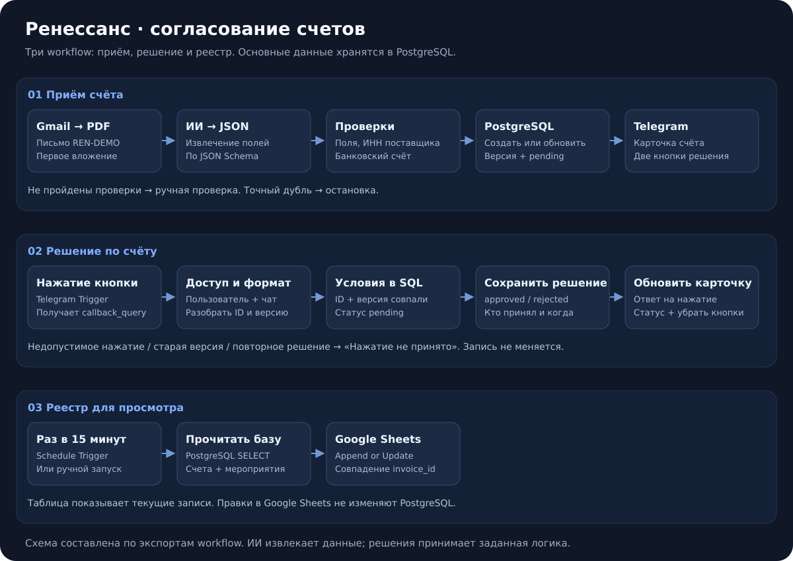
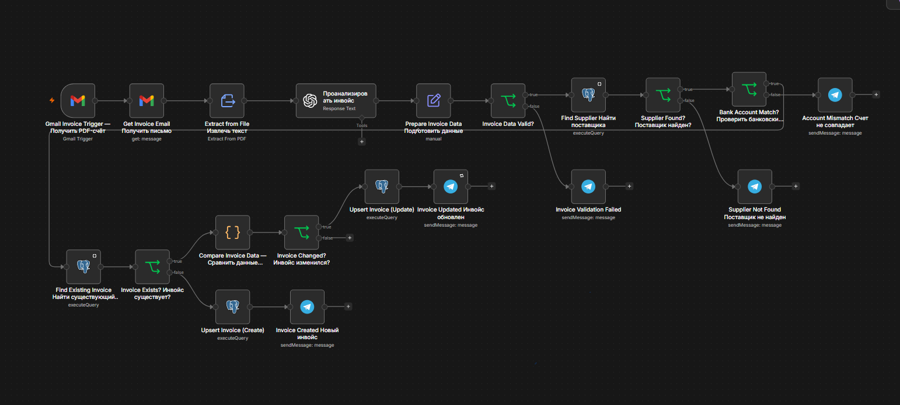
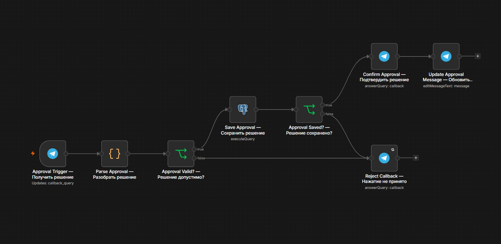
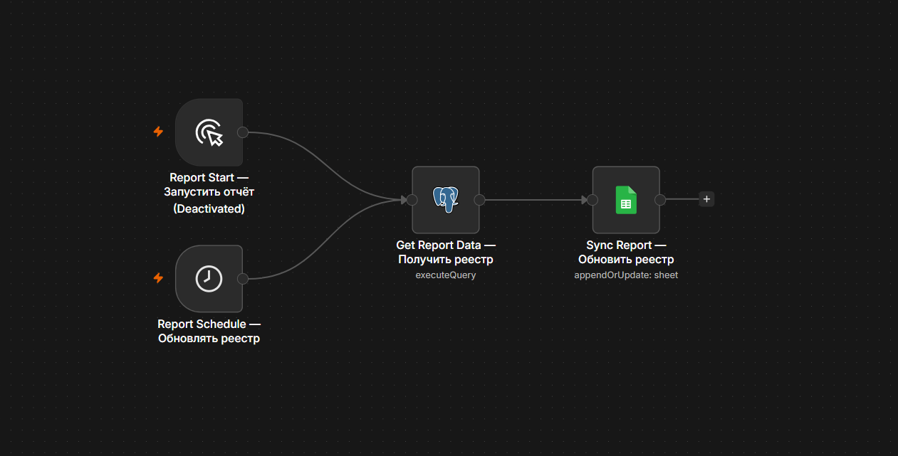

# Ренессанс: согласование счетов в Telegram

Пилот на **n8n**: получает PDF-счёт из Gmail, извлекает данные с помощью ИИ, проверяет поставщика и реквизиты, сохраняет счёт в PostgreSQL и отправляет на согласование в Telegram. Google Sheets показывает актуальный реестр.

**Статус:** пилот проверен вручную на основных сценариях. Внедрение в бухгалтерию и экономический эффект не заявляются. Оплаты система не выполняет.

## Какая задача решается

Счёт приходит по почте. Нужно проверить, от кого он, не изменились ли реквизиты, не обрабатывался ли он раньше и кто принял решение. Пилот связывает эти шаги в один процесс и останавливает сомнительные случаи для ручной проверки.

## Как работает

| Workflow | Что делает | Запуск |
| --- | --- | --- |
| [Приём счёта](workflows/invoice-intake.json) | Извлекает данные, проверяет реквизиты, создаёт или обновляет запись, отправляет кнопки | Gmail, опрос раз в минуту |
| [Решения по счетам](workflows/invoice-approvals.json) | Проверяет пользователя, версию и статус, сохраняет решение, обновляет сообщение | Нажатие кнопки Telegram |
| [Отчёт](workflows/invoice-report.json) | Добавляет или обновляет строки Google Sheets по `invoice_id` | Каждые 15 минут |

Приём и обработка решений связаны через **одного Telegram-бота**. Приём отправляет кнопку, а Telegram Trigger в workflow решений получает нажатие. Отчёт читает данные из PostgreSQL.

## Скриншоты workflow

### 1. Приём и обработка счёта

Получает PDF из Gmail, извлекает данные и проверяет поставщика, банковский счёт и дубли. Новый счёт сохраняется; при изменении данных увеличивается версия и отправляется повторное согласование в Telegram. Точный дубль останавливается без нового сообщения.

### 2. Решения по счетам в Telegram

Получает нажатие кнопки и проверяет пользователя и чат. Сохраняет решение только для актуальной версии со статусом `pending`, затем обновляет сообщение. Старые кнопки и повторное решение той же версии отклоняются.

### 3. Отчёт в Google Sheets

Каждые **15 минут** читает актуальные данные из PostgreSQL и обновляет реестр. По `invoice_id` находит существующую строку или добавляет новую, поэтому повторная выгрузка не создаёт дубль.

## Пример

1. Пришёл новый счёт на **10 000 ₽** → версия **1**, статус `pending`, кнопки в Telegram.
2. Повторили тот же документ → изменений и нового сообщения нет.
3. Прислали тот же номер счёта на **11 000 ₽** → версия **2**, статус снова `pending`.
4. Нажали кнопку версии 1 → отказ: она относится к старым данным.
5. Согласовали версию 2 → `approved`, сохранены пользователь и время, кнопки убраны.
6. Попытались принять ещё одно решение по версии 2 → отказ: она уже рассмотрена.
7. При следующем запуске отчёта обновляется та же строка Google Sheets.

Пример выше использует вымышленные суммы. Результаты проверки реального пилота описаны отдельно в [журнале проверок](docs/test-results.md).

## Правила

- Поставщик ищется по **ИНН** в справочнике PostgreSQL.
- Банковский счёт из PDF должен совпадать со счётом из справочника.
- Инвойс ищется по паре **ИНН поставщика + номер счёта**.
- Точный дубль не обновляет запись и не увеличивает версию.
- При изменении данных увеличивается версия и сбрасываются решение, автор и время согласования.
- Решение записывается только при совпадении **ID + версии + статуса `pending`**.
- Неизвестный поставщик, неполные данные или несовпадение реквизитов вызывают уведомление о ручной проверке.
- ИИ извлекает поля. Проверки и запись решения выполняют IF, JavaScript и SQL.

`pending` — ждёт решения, `approved` — согласован, `rejected` — отклонён. Поле `status = processed` отдельно описывает обработку документа и не означает согласование.

## Что проверили

| Сценарий | Результат |
| --- | --- |
| Неизвестный поставщик | Уведомление, счёт не записан |
| Новый счёт | Версия 1, ожидание согласования, кнопки |
| Точный дубль | Остановка без обновления и нового сообщения |
| Изменение суммы | Новая версия, повторное согласование |
| Старая кнопка | Решение не применяется |
| Согласование и отказ | Решение сохраняется, сообщение обновляется |
| Повторное решение той же версии | Доступ проходит, сохранение отклоняется |
| Несовпадение банковского счёта | Остановка до записи; исправлен текст уведомления |
| Повторная выгрузка Google Sheets | Та же строка обновляется без дубля |
| Нажатие чужим Telegram-аккаунтом | Проверка предусмотрена, вручную ещё не проверено |

## Запуск демонстрации

В папке есть три очищенных JSON, [схема и начальные данные](sql/), [вымышленные PDF](demo/) и [пошаговая настройка](docs/setup.md).

Credentials и персональные ID удалены. Workflow выключены; перед запуском нужно подключить свои аккаунты и заменить `YOUR_...`. Логика исходных workflow сохранена. Схема базы восстановлена по запросам, а не выгружена из рабочей базы.

## Ограничения пилота

- Обрабатывается первое вложение `attachment_0`; сканированные PDF требуют отдельного OCR.
- Выставка и категория задаются вручную в ноде подготовки данных.
- Текущая проверка обязательных полей опирается на `missing_fields` от модели; нужна независимая проверка значений. `document_type` извлекается, но отдельного запрета для `not_invoice` в экспортe нет.
- В PostgreSQL хранится текущая версия. Полной истории версий и решений пока нет.
- Реестр обновляется по расписанию: изменение в Telegram не означает мгновенное изменение Google Sheets. Ручные правки таблицы не меняют базу; удалённые из базы строки автоматически не удаляются из реестра.
- Поздно пришедший старый PDF может считаться очередным изменением: защита версий действует для кнопок, а не для порядка писем.
- Не проверены одновременные поступления, конкурентные обновления и восстановление после ошибок API. Запись в PostgreSQL и уведомление Telegram не являются одной транзакцией.
- Численное сокращение времени обработки не измерялось; пилот не заменяет бухгалтерский учёт.

## Автор

[Alexander Zaytsev](https://github.com/AlexZaytsev-ai) — автоматизация бизнес-процессов на n8n.

Технологии: **n8n · Gmail · OpenAI · PostgreSQL · Telegram Bot API · Google Sheets · JavaScript · SQL**.
